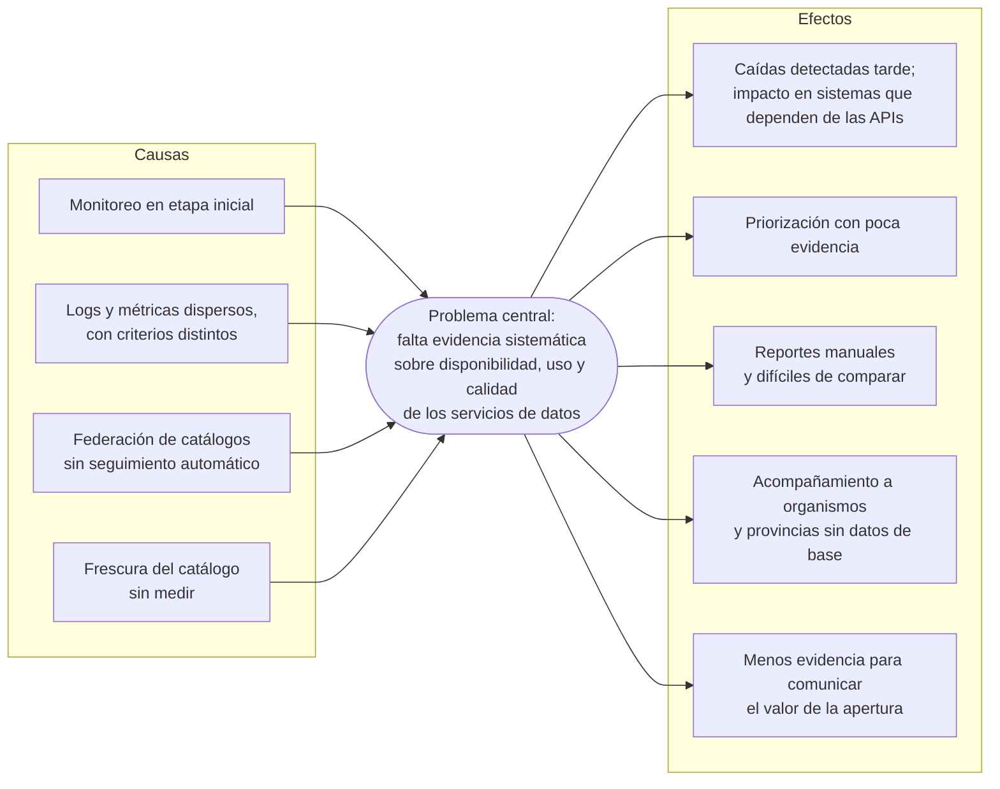
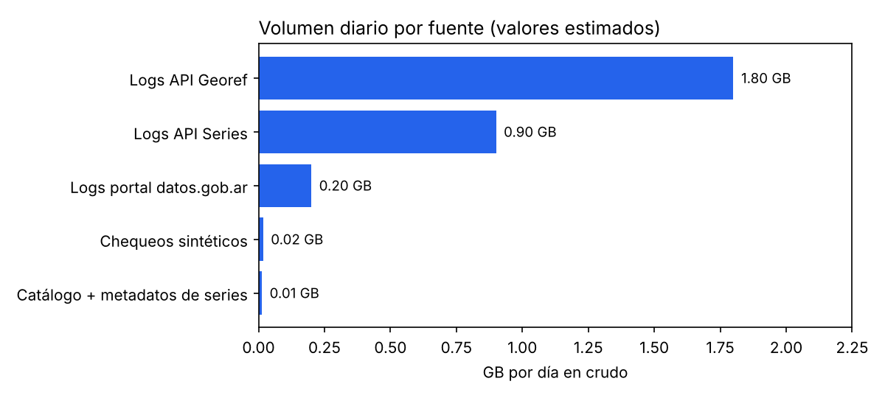
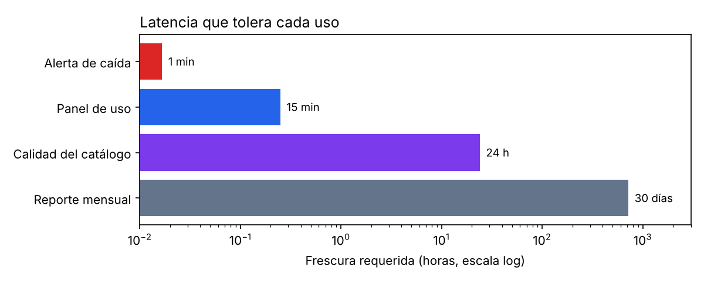
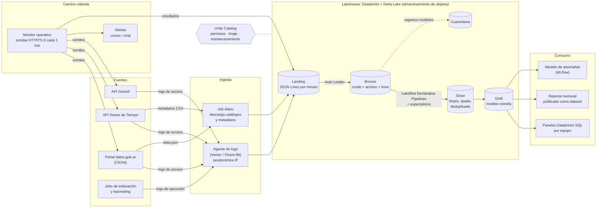
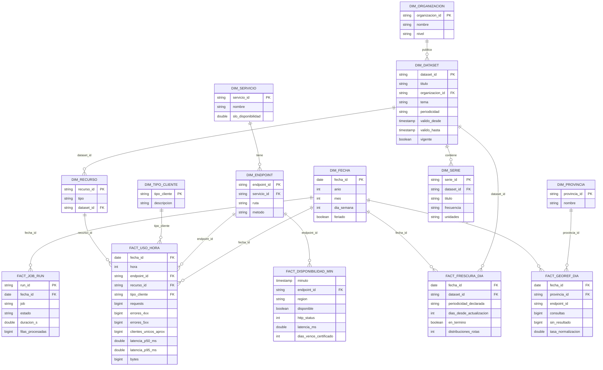
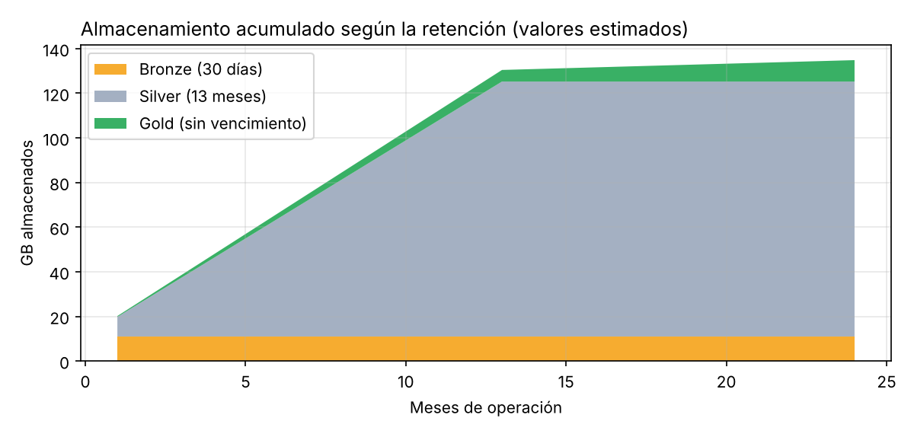

# Observatorio de servicios de datos abiertos

Caso de negocio y arquitectura de datos para monitorear la disponibilidad, el uso y la calidad de datos.gob.ar, la API de Series de Tiempo y la API Georef.

> **Nota sobre el alcance.** Es un trabajo académico. Describo la situación en términos generales, a partir de información pública y de supuestos propios; no es una posición oficial ni usa datos internos de los organismos mencionados. Los volúmenes, las tasas y las metas son estimaciones para dimensionar la propuesta: los marco con **(E)** y los calculo en [`graficos/generar_graficos.py`](graficos/generar_graficos.py), donde se pueden reemplazar por valores reales.

## 1. Necesidad de negocio

### La organización y su mandato

La Dirección Nacional de Gobierno Abierto (DNGA) depende de la Secretaría de Innovación, Ciencia y Tecnología de la Jefatura de Gabinete de Ministros. Para este caso me interesa que cumple dos roles a la vez:

- **Rectora de la política de apertura.** Coordina los planes de acción nacionales de gobierno abierto. Hoy está en marcha el Sexto Plan de Acción Nacional (2025-2027). El marco normativo incluye el Decreto 117/2016 (Plan de Apertura de Datos) y la Ley 27.275 de acceso a la información pública.
- **Operadora de infraestructura pública de datos.** Mantiene el portal nacional y dos APIs que usan otros organismos y terceros.

Los tres servicios son:

| Servicio | Qué ofrece | Base técnica | Quién lo usa |
|---|---|---|---|
| datos.gob.ar | Portal y catálogo nacional. Federa por *harvesting* los catálogos de los organismos | CKAN (Andino) con el perfil de metadatos del Paquete de Apertura de Datos | Organismos publicadores, periodistas, academia, sociedad civil |
| API Series de Tiempo | Miles de indicadores por ID, con transformaciones y salida CSV/JSON | Django + Elasticsearch | Tableros, investigaciones y aplicaciones con indicadores oficiales |
| API Georef | Normalización y georreferenciación de direcciones y unidades territoriales, también por lotes | API REST v2.0 | Sistemas de otros organismos que normalizan registros, y librerías de terceros como el paquete `georefar` de R |

Estos servicios funcionan como infraestructura: si Georef deja de responder, se frenan procesos de otros organismos que la integran. Al mismo tiempo, la política de apertura que promueve la Dirección pide medir, publicar y rendir cuentas. El desafío que tomo en este trabajo es contar con **evidencia sistemática sobre el funcionamiento, el uso y la calidad de los propios servicios**, en línea con lo que esa política propone para el resto del Estado.

### Situación actual y por qué importa

| Situación | Por qué importa |
|---|---|
| El monitoreo de los servicios está en una etapa inicial y no hay una plataforma que integre los distintos registros | Una caída o una degradación puede pasar inadvertida hasta que la reporta un usuario, y no hay forma de medir un nivel de servicio |
| Las métricas de uso salen de fuentes distintas (analítica web del portal, logs de cada servidor), cada una con su criterio | Cuesta armar series comparables en el tiempo para priorizar y para mostrar impacto. La analítica web, además, no cubre las APIs |
| La federación de catálogos depende de que los portales de cada organismo respondan bien, y la plataforma va sumando componentes nuevos | Cuando un proceso falla hay que revisarlo caso por caso, y crece el riesgo de que algo deje de actualizarse sin que se note |
| La calidad del catálogo depende de cada organismo y su frescura no se mide en forma sistemática | Es difícil orientar el acompañamiento a los organismos: no se sabe bien cuáles están atrasados ni qué datasets son los más usados |
| Los reportes de uso se arman a mano para informes de avance y presentaciones | Llevan tiempo y las cifras son difíciles de reproducir de un informe a otro |
| Las direcciones que Georef no logra normalizar no se analizan | Se pierde una pista sobre dónde faltan o están desactualizados los datos territoriales de referencia |

El siguiente árbol de problemas resume el diagnóstico:



### Por qué ahora

- Cualquier herramienta de monitoreo que se encare puede diseñarse desde el principio para alimentar una capa analítica común, en vez de integrarla después.
- La plataforma sigue evolucionando. Definir ahora un formato común para logs y procesos es más barato que adaptar cada sistema más adelante.
- El Sexto Plan está en implementación. Uno de sus compromisos, *Desarrollo de Capacidades para un Estado Abierto*, lo lidera la DNGA junto con la Subsecretaría de Relaciones Municipales y ofrece acompañamiento técnico a provincias y municipios. Saber qué datos y servicios se usan, y desde qué territorios, sirve como insumo para ese acompañamiento. Y una plataforma documentada puede servir de referencia para portales provinciales y municipales.
- Publicar como dato abierto los indicadores de uso y disponibilidad de los propios servicios es coherente con lo que la Dirección promueve en otros organismos.

### Usuarios

| Usuario | Qué hace | Qué necesita |
|---|---|---|
| Equipo que opera las APIs | Mantiene Georef y Series | Enterarse de una caída antes que los usuarios; latencia y errores por endpoint; direcciones no normalizadas por provincia |
| Equipo de datos abiertos | Cura el portal y los catálogos federados | Frescura por dataset y organismo, enlaces rotos, estado del *harvesting*, uso por dataset |
| Equipo de políticas de gobierno abierto | Plan de acción, compromisos, vínculo con OGP, provincias y municipios | Indicadores de impacto que se puedan reproducir; uso por territorio |
| Dirección | Prioriza recursos y rinde cuentas | Un tablero mensual de disponibilidad y uso |
| Organismos publicadores, provincias y municipios | Producen los datos que se federan | Ver el uso y la calidad de lo que publican |
| Reutilizadores (sociedad civil, periodistas, academia, empresas, otros sistemas del Estado) | Consumen los servicios | Servicios estables, datos al día y métricas públicas |

### Objetivo

Propongo una plataforma de datos que junte logs de acceso, chequeos de disponibilidad, ejecuciones de procesos y metadatos de los catálogos para responder tres preguntas: *¿funciona?*, *¿se usa?* y *¿está al día?*

La plataforma complementa al monitoreo operativo y no lo reemplaza: la alerta inmediata queda en el monitor, y la plataforma suma la historia, el análisis y los reportes.

### Preguntas de negocio

| # | Pregunta | Usuario principal |
|---|---|---|
| P1 | ¿Cada servicio y endpoint está disponible ahora? ¿Con qué latencia? | Equipo de las APIs |
| P2 | ¿Qué datasets, series y endpoints se usan más, por qué tipo de cliente y con qué tendencia? | Datos abiertos, Dirección |
| P3 | ¿Qué datasets están desactualizados respecto de su periodicidad declarada, y de qué organismo son? | Datos abiertos, publicadores |
| P4 | ¿Qué consultas a Georef no se normalizan y en qué provincias se concentran? | Equipo de las APIs |
| P5 | ¿Hay anomalías de tráfico (picos, scraping, errores masivos)? | Equipo de las APIs |
| P6 | ¿Qué disponibilidad mensual tuvo cada servicio y cómo evolucionó su uso? | Dirección, políticas de gobierno abierto |
| P7 | ¿Qué procesos de indexación y *harvesting* fallaron, de qué catálogo y hace cuánto? | Datos abiertos |

### Beneficios esperados y cómo medir el éxito

| Indicador | Línea de base | Meta a 6 meses |
|---|---|---|
| Tiempo medio de detección de una caída | Horas **(E)** | Menos de 2 minutos |
| Disponibilidad mensual por servicio | Sin medición sistemática | Medida en todos los endpoints, con objetivo de 99,5 % |
| Serie de uso (requests y clientes únicos) comparable en el tiempo | Sin una definición única | Definición documentada y estable |
| Fallas de *harvesting* e indexación detectadas automáticamente | Revisión caso por caso | Todas detectadas en menos de 24 h |
| Datasets actualizados en término | Sin medir | Medido, y 20 puntos porcentuales arriba de la primera medición |
| Tiempo para armar el reporte mensual de uso | ~3 días-persona **(E)** | Automático |
| Indicadores de uso y disponibilidad publicados como dataset abierto | No existen | Publicación mensual en datos.gob.ar |

Si no se hace nada, la detección de caídas sigue dependiendo de los usuarios, las decisiones se toman con poca evidencia y cada reporte se arma a mano.

## 2. Datos

### Fuentes

| Fuente | Tipo | ¿Disponible? | Volumen | Frecuencia | Calidad esperada | Sensibilidad |
|---|---|---|---|---|---|---|
| Logs de acceso del portal (servidor web/CDN) | Semiestructurado (JSON Lines) | Se generan; hay que enviarlos a la plataforma | ~400 mil eventos/día **(E)** | Continua (archivos cada 1 min) | Bots, líneas truncadas, duplicados por reintentos | IP y user agent: datos personales |
| Logs de la API Series (servidor web + parámetros de consulta) | Semiestructurado | Ídem | ~1,5 M/día **(E)** | Continua | IDs de series inválidos, consultas masivas | IP, user agent |
| Logs de la API Georef (con cantidad de resultados) | Semiestructurado | Ídem | ~3 M/día **(E)** | Continua | Consultas por lotes con cientos de direcciones | IP; las direcciones consultadas pueden ser de personas |
| Chequeos sintéticos (sondas HTTP y TLS) | Estructurado | A construir, como parte del monitor | ~58 mil/día **(E)**: 3 servicios × ~20 endpoints × 2 regiones × 1 por minuto | Cada 1 min | Alta, porque los genera la plataforma | Ninguna |
| Catálogo de datasets (`data.json` / API de CKAN) | JSON con el perfil de metadatos | Disponible y público | ~10 MB por snapshot **(E)** | Diaria | Periodicidad o fechas faltantes, enlaces rotos | Pública |
| Metadatos de series (CSV que publica la API Series) | CSV | Disponible y público | ~2,5 MB por snapshot **(E)** | Diaria | Buena | Pública |
| Ejecuciones de procesos (indexación de series, *harvesting*) | Logs de jobs | Existen; hay que centralizarlos | ~200/día **(E)** | Por ejecución | Formatos distintos según el proceso | Interna |



Con estos supuestos son unos 5 millones de eventos por día: ~57 por segundo en promedio y ~600 en un pico de 10×. En crudo son ~2,9 GB/día y en Parquet/Delta ~0,3 GB/día **(E)**.

La escala es moderada. Lo que hace a este caso un problema de Big Data no es tanto el volumen sino la **variedad** de fuentes (logs, catálogos, sondas, jobs), la **velocidad** que piden las alertas y la **historia** que se acumula para analizar tendencias.

### Restricciones

- **Datos personales (Ley 25.326):** las IP y las direcciones consultadas a Georef no se pueden guardar en claro.
- **Equipo chico:** la operación tiene que ser simple; conviene usar servicios gestionados.
- **Presupuesto público:** costos predecibles, sin clusters prendidos todo el día.
- **El monitoreo no puede afectar a los servicios:** la recolección de logs tiene que ser asíncrona.

## 3. Arquitectura propuesta

Separé la solución en dos caminos porque los usos toleran latencias muy distintas:



- **Camino caliente (operativo):** un monitor liviano corre las sondas y avisa en menos de un minuto. No depende del lakehouse, así que si falla la plataforma analítica las alertas siguen funcionando. Además, publica cada resultado como un evento.
- **Camino analítico (lakehouse):** arquitectura medallion sobre Delta Lake en Databricks, con ingesta incremental continua para los logs y procesos diarios para los catálogos.



### Tecnologías por función

| Función | Tecnología | Para qué |
|---|---|---|
| Recolección de logs | Vector (o Fluent Bit) en los servidores | Lee los logs del servidor web, seudonimiza la IP en origen y deja un archivo JSON Lines por minuto |
| Monitor operativo | Servicio liviano propio (sondas + alertas) | Disponibilidad, latencia, vencimiento de certificados y dominios |
| Almacenamiento | Almacenamiento de objetos en la nube + Delta Lake | Capas Bronze/Silver/Gold con versionado y *time travel* |
| Ingesta incremental | Auto Loader (Structured Streaming, disparo cada 5 min) | Procesa sólo los archivos nuevos; el checkpoint permite retomar después de una falla |
| Transformación y calidad | Lakeflow Declarative Pipelines con *expectations* | Reglas declarativas; lo inválido va a cuarentena con su motivo |
| Orquestación | Databricks Jobs | Pipeline continuo para los logs, jobs diarios para catálogos y agregados, y uno mensual para el reporte |
| Gobierno | Unity Catalog | Permisos por esquema, linaje, enmascaramiento de columnas y auditoría |
| Visualización | Paneles de Databricks SQL con alertas | Un panel por equipo: disponibilidad para las APIs, frescura y uso para datos abiertos, y el reporte mensual para la Dirección |
| Publicación | Job mensual | Publica el reporte agregado de uso como dataset abierto en datos.gob.ar |

### Recorrido de un evento

1. Un usuario pide `/series/api/series/?ids=…` y el servidor web escribe la línea de log.
2. Vector reemplaza la IP por un hash con sal rotativa (más la red /24) y junta un archivo por minuto en *landing*.
3. Auto Loader detecta el archivo nuevo y lo agrega a Bronze tal cual, con el archivo de origen y la hora de ingesta.
4. El pipeline parsea, tipa, extrae los IDs de las series consultadas, clasifica el cliente (navegador, script, bot conocido) y deduplica por `request_id`. Lo que no cumple las reglas va a cuarentena.
5. Cada hora, y al cierre del día, se actualizan los agregados Gold con `MERGE`, de forma idempotente.
6. Los paneles leen Gold. Si el servicio se hubiera caído, el monitor operativo ya habría avisado por su cuenta, sin esperar este recorrido.

## 4. Modelado de datos

### Capas

| Capa | Tablas | Granularidad | Partición / clustering |
|---|---|---|---|
| Bronze | `bronze_logs_acceso`, `bronze_sondas`, `bronze_jobs`, `bronze_catalogo`, `bronze_series_meta` | Línea o archivo tal como llegó | Fecha de ingesta |
| Silver | `silver_requests` | 1 fila por request válido | Partición por `fecha`; *liquid clustering* por `servicio, recurso_id` |
| Silver | `silver_sondas` | 1 fila por sonda × endpoint × región × minuto | `fecha` |
| Silver | `silver_job_runs` | 1 fila por ejecución | `fecha` |
| Silver | `silver_datasets`, `silver_series` | 1 fila por entidad, historizada (SCD tipo 2) | (sin partición) |
| Gold | Modelo estrella (abajo) | Según cada hecho | `fecha` |

`silver_requests` unifica los tres servicios con columnas comunes (`ts`, `servicio`, `endpoint`, `status`, `latencia_ms`, `bytes`, `cliente_hash`, `tipo_cliente`) y un campo `recurso_id`, que en el portal es el `dataset_id`, en Series es cada ID consultado (una fila por ID, con *explode*) y en Georef es la entidad consultada. Lo propio de cada servicio va en una columna `detalle` de tipo struct: las transformaciones de Series, o la cantidad de resultados y la provincia de Georef.

### Modelo estrella (Gold)



Sobre las claves:
- Uso las claves naturales de los sistemas de origen: el `id` de CKAN para los datasets, el ID de serie de la API y los códigos oficiales de provincia de Georef. Así el modelo se cruza directo con los catálogos publicados.
- `DIM_DATASET` es SCD tipo 2: si un dataset cambia de organismo o de periodicidad, la frescura histórica se evalúa con la regla que regía en ese momento.
- `cliente_hash` = SHA-256(IP /24 + user agent + sal mensual). Sirve para contar clientes únicos dentro de un mes sin poder volver a la IP. Como la sal rota, no se puede seguir a una persona de un mes a otro.

### Cómo responde cada pregunta

| Pregunta | Tablas | Ejemplo |
|---|---|---|
| P1 Disponibilidad ahora | Monitor operativo; `FACT_DISPONIBILIDAD_MIN` para la historia | Último estado por endpoint |
| P2 Uso | `FACT_USO_HORA` ⋈ `DIM_RECURSO` ⋈ `DIM_DATASET` / `DIM_SERIE` | Top 20 series por requests, sin bots, últimos 30 días |
| P3 Frescura | `FACT_FRESCURA_DIA` ⋈ `DIM_DATASET` ⋈ `DIM_ORGANIZACION` | % de datasets en término por organismo |
| P4 Georef | `FACT_GEOREF_DIA` ⋈ `DIM_PROVINCIA` | Provincias con mayor tasa de direcciones sin resultado |
| P5 Anomalías | `FACT_USO_HORA` (serie horaria) + el modelo de la sección 6 | Horas fuera del intervalo esperado |
| P6 Reporte mensual | `FACT_DISPONIBILIDAD_MIN` y `FACT_USO_HORA` agregados por mes | Disponibilidad % y requests por servicio |
| P7 Procesos | `FACT_JOB_RUN` ⋈ `DIM_FECHA` | Jobs de *harvesting* fallidos por catálogo en las últimas 24 h |

Por ejemplo, para P3:

```sql
SELECT o.nombre AS organismo,
       count(*)                                       AS datasets,
       round(avg(CAST(f.en_termino AS INT)) * 100, 1) AS pct_en_termino
FROM gold.fact_frescura_dia f
JOIN gold.dim_dataset d      ON d.dataset_id = f.dataset_id AND d.vigente
JOIN gold.dim_organizacion o ON o.organizacion_id = d.organizacion_id
WHERE f.fecha_id = current_date() - 1
GROUP BY o.nombre
ORDER BY pct_en_termino;
```

## 5. Justificación de las decisiones

| Decisión | Alternativa descartada | Por qué | Costo o limitación |
|---|---|---|---|
| Dos caminos (monitor operativo + lakehouse) | Alertar desde el lakehouse | La alerta tiene que salir en menos de 1 min y no puede depender de la plataforma que se está monitoreando | Hay que mantener dos componentes |
| Lakehouse Delta sobre almacenamiento de objetos | Data warehouse relacional (PostgreSQL) | Logs semiestructurados, ingesta continua y ~1,1 TB/año en crudo **(E)**. Delta da ACID, *time travel* y almacenamiento barato | Con la escala actual, PostgreSQL alcanzaría para Gold; el lakehouse se justifica por la variedad de fuentes y el crecimiento |
| Archivos por minuto + Auto Loader | Kafka | Con ~57 eventos/s **(E)** no se justifica operar un cluster de Kafka; con archivos alcanza para una frescura de 5 min | La latencia analítica es de minutos, no de segundos. Si apareciera un caso en tiempo real, se puede sumar Kafka sin tocar Silver ni Gold |
| Seudonimizar en origen | Guardar la IP y enmascararla después | Minimiza los datos personales (Ley 25.326): la IP nunca llega al lago | No se puede reconstruir la IP para investigar un ataque; para eso quedan los logs del servidor, con retención corta |
| Pipelines declarativos con *expectations* | Validaciones sueltas en notebooks | Reglas versionadas, métricas de calidad automáticas y cuarentena | Más dependencia de Databricks |
| Modelo estrella en Gold | Una sola tabla ancha | Varias preguntas comparten dimensiones (dataset, organismo, fecha) y el SCD2 mantiene bien la historia | Más tablas y joins; se compensa con vistas por panel |
| Agregado horario en `FACT_USO_HORA` | Consultar `silver_requests` directo | Silver suma ~5 M filas/día **(E)**; el agregado horario es una fracción y los paneles salen rápidos y baratos | El detalle por request sólo dura 13 meses en Silver |
| Retención: Bronze 30 días, Silver 13 meses, Gold sin vencimiento | Guardar todo | Costo acotado (~135 GB a 24 meses **(E)**, ver gráfico) y menos exposición de datos | Para reprocesar más de 30 días atrás hay que partir de Silver |
| Databricks gestionado (serverless) | Stack open source (MinIO + Spark + Airflow + Superset) | Con un equipo chico importa operar poco; además el gobierno de datos viene integrado y el cómputo se paga sólo cuando corre | Costo por uso y dependencia del proveedor. El stack open source es viable si el presupuesto lo pide, a cambio de más horas de operación |



### Seguridad y gobierno

- Esquemas separados por capa, con permisos por rol:
  - el equipo de las APIs lee Gold de disponibilidad y Georef;
  - el de datos abiertos lee frescura, uso y procesos;
  - el de políticas de gobierno abierto y la Dirección leen los agregados mensuales;
  - Bronze sólo lo ve el equipo de datos.
- Cada organismo publicador ve sólo sus datasets, con filtros de fila en Unity Catalog.
- Las direcciones consultadas a Georef no se guardan: sólo la provincia o el departamento resueltos y si hubo resultado.
- El reporte público sale agregado, sin `cliente_hash` ni detalle por request.

### Limitaciones

- Los volúmenes son estimaciones; habría que validarlos con una semana real de logs antes de cerrar el dimensionamiento.
- Clasificar clientes (bot, script, navegador) por user agent es imperfecto.
- Los usuarios detrás de un mismo NAT cuentan como un solo cliente.
- Las sondas miden la disponibilidad desde la nube, no desde la red de cada usuario.

## 6. Extensión MLOps: detección de anomalías de tráfico

| Aspecto | Propuesta |
|---|---|
| Objetivo | Predecir los requests por hora de cada servicio y endpoint, y marcar como anomalía lo que quede fuera del intervalo de predicción (responde P5). Sirve para detectar scraping, caídas silenciosas (el tráfico cae a cero pero el servicio responde HTTP 200) y picos por noticias |
| Datos | `FACT_USO_HORA` por hora y endpoint. Como etiquetas débiles, los incidentes registrados por el equipo de las APIs |
| Features | Hora, día de la semana, feriado, rezagos (t-1, t-24, t-168), media móvil de 7 días, tasa de errores 5xx, proporción de bots |
| Modelos a comparar | Una línea de base estacional (mismo horario de la semana anterior) contra un gradient boosting con cuantiles (p05 a p95) |
| Partición | Temporal: 8 semanas de entrenamiento, 1 de validación y 1 de test, con ventana deslizante |
| Tracking | MLflow: parámetros, MAPE, cobertura del intervalo, precision/recall contra incidentes conocidos y gráficos de residuos |
| Registro y uso | Unity Catalog con alias `champion`. Un job puntúa cada hora y escribe `gold_anomalias` con `model_version`, `run_id` y umbral |
| Monitoreo | Cobertura real del intervalo, alertas por semana (para no saturar al equipo que las atiende) y drift de las features. Reentrenamiento semanal; el champion cambia sólo si el nuevo modelo mejora en validación |

## Referencias

- Portal nacional de datos abiertos: <https://datos.gob.ar>
- API Series de Tiempo, código y arquitectura: <https://github.com/datosgobar/series-tiempo-ar-api>
- API Series de Tiempo, documentación: <https://series-tiempo-ar-api-english.readthedocs.io/>
- API Georef, normalización de direcciones: <https://www.argentina.gob.ar/georef/normalizacion-de-direcciones>
- API Georef, consultas por lotes: <https://www.argentina.gob.ar/node/473631>
- Paquete de Apertura de Datos (perfil de metadatos): <https://datosgobar.github.io/paquete-apertura-datos/guia-apn/>
- Gobierno Abierto, Jefatura de Gabinete de Ministros (Sexto Plan de Acción Nacional 2025-2027): <https://www.argentina.gob.ar/node/58714>
- OGP, *Estado abierto en Argentina: avances y desafíos futuros*: <https://www.opengovpartnership.org/es/stories/open-state-in-argentina-progress-and-challenges-ahead/>
- Decreto 117/2016, Plan de Apertura de Datos: <https://www.argentina.gob.ar/normativa/nacional/257755/texto>
- Ley 27.275 de Derecho de Acceso a la Información Pública.
- Ley 25.326 de Protección de los Datos Personales.
- Paquete `georefar` (cliente R de la API Georef): <https://stat.ethz.ch/CRAN/web/packages/georefar/index.html>
